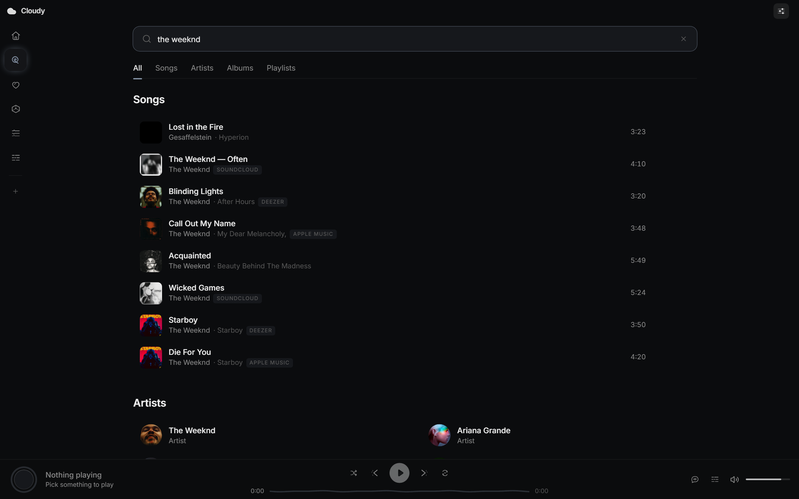
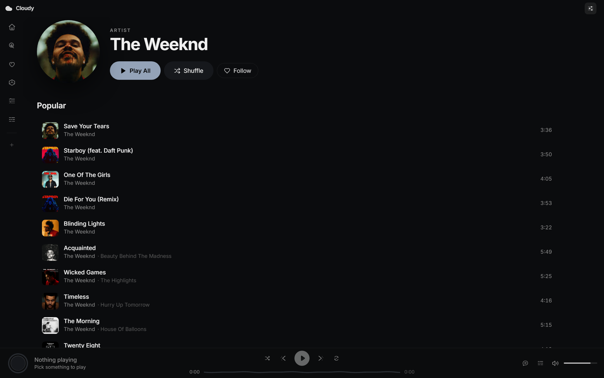
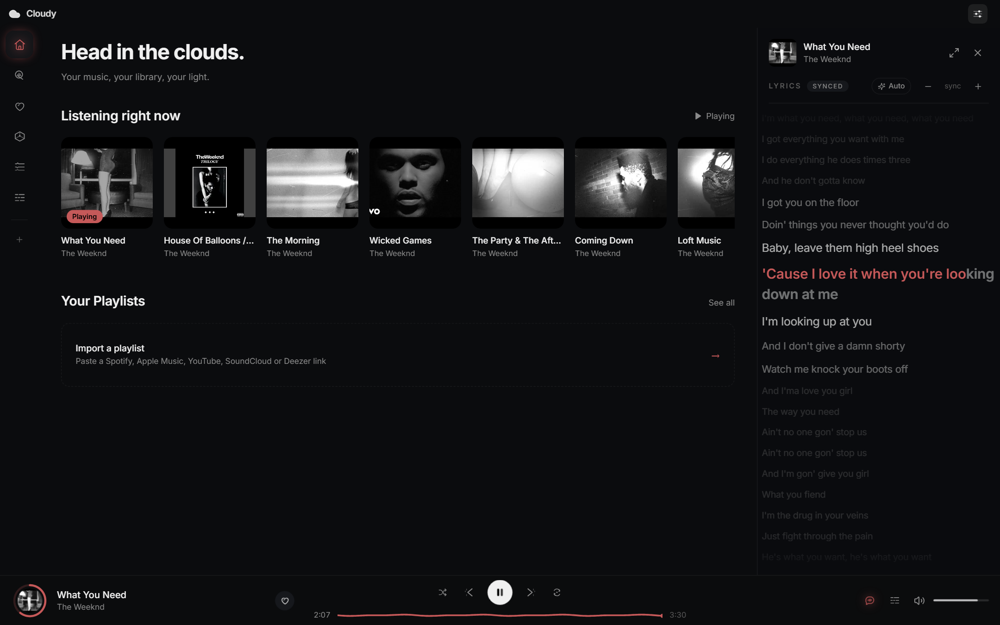
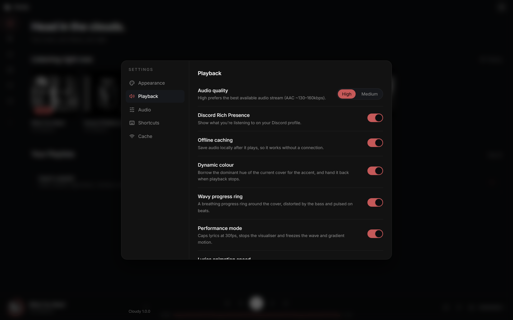

# Cloudy

**Head in the clouds.** A desktop music player that searches YouTube Music, SoundCloud, Deezer and Apple Music at once — no account, no ads, no recommendation feed, no telemetry.

[](https://github.com/Toastyfil/cloudy-music-player/raw/main/docs/cloudy-promo.mp4)

<p align="center"><sub>25-second tour — <a href="https://github.com/Toastyfil/cloudy-music-player/raw/main/docs/cloudy-promo.mp4">watch with sound</a> (MP4, 1080p)</sub></p>


---

## What it is

Cloudy is a music player for Windows and macOS. One search box queries four catalogs and interleaves their results, each row labelled with the service it came from, deduplicated so the same song does not appear four times. Every result plays through Cloudy's own player: one queue, one volume, one lyrics view — and after the first listen, straight from disk.

It is deliberately small in scope. There is no feed, no "for you" page, no social layer and no login. Type a song, a record or an artist, press play.

---

## Features

**One search, four catalogs**
YouTube Music, SoundCloud, Deezer and Apple Music are searched together and merged into a single result list. External hits are matched to the recording Cloudy plays, so a Deezer or SoundCloud result is not a link out — it is the track, ad-free, in your queue.

**Lyrics that follow the voice**
Syllable-timed LRC with a karaoke sweep across the line being sung, distance-based typography that keeps the next lines readable, and backing vocals dimmed rather than shouted. Drag or wheel the lyrics and auto-scroll pauses, then picks up again a few seconds later.

**Alignment you do not have to think about**
Recordings do not always match the timing of the lyric file — a YouTube upload with a longer intro is the usual culprit. Cloudy analyses the audio itself: it isolates the vocal band, builds a loudness envelope and finds the shift where the lyric lines line up with the singing. That runs once per track the first time you play it, is remembered, and can be redone from the lyrics panel with one press of **Auto**. There is also a manual nudge and a "sync this line to the playhead" control for anything stubborn.

**Playback that respects the queue**
Gapless prefetch of the next tracks, fades instead of clicks, a 10-band EQ, stereo pan, mono output, drive, delay, reverb, compression and loudness normalisation. The audio engine ignores a late `play()` from a track you already skipped, so switching songs never gives you a burst of the previous one.

**A real music library**
Favorites for songs, artists and albums, playlists you create, and playlist import from Spotify, Apple Music, YouTube, SoundCloud or Deezer links. Recently played and play counts are kept locally and shown on Home.

**Makes itself at home on either OS**
Native Windows frame controls; on macOS the real traffic lights under a hidden title bar and a proper template icon in the menu bar. A tray/menu-bar menu with transport controls, OS media keys, Discord presence, global shortcuts and `cloudy://` deep links.

**21 palettes, 47 languages**
Dark, light and tinted themes plus a choice of logo marks, and an interface translated into 47 languages — all applied instantly, no restart.

---

## Screenshots

Taken from the app running at 1440 × 900 on the Graphite palette.

| | |
| --- | --- |
| **Search** — four catalogs in one list, each labelled<br> | **Artist** — popular tracks, follow, play all<br> |
| **Releases** — albums, singles and related artists<br> | **Album** — cover, year, runtimes, catalog order<br> |
| **Lyrics** — syllable sweep, active line in the accent colour<br> | **Fullscreen lyrics** — wavy progress ring, `F` to exit<br> |
| **Queue** — reorder, remove, shuffle, repeat<br> | **Appearance** — 21 palettes and 47 languages<br> |
| **Playback settings** — fades, Discord presence, cache, media controls<br> | |

---

## Install

Everything is published on the [Releases page](https://github.com/Toastyfil/cloudy-music-player/releases).

**Windows** — download `Cloudy-<version>-setup.exe` and run it. The installer bundles `yt-dlp`, so playback works without installing anything else.

**macOS** — `Cloudy-<version>-arm64.dmg` for Apple Silicon, `Cloudy-<version>-x64.dmg` for Intel. Open the DMG and drag Cloudy to Applications.

The macOS builds are not yet signed with an Apple Developer ID, so the first launch is blocked by Gatekeeper. Either right-click the app → **Open** → **Open**, or clear the quarantine flag once:

```sh
xattr -dr com.apple.quarantine /Applications/Cloudy.app
```

Upgrades keep your library, playlists, settings and cached audio.

---

## Build from source

Requirements: Node 22+, npm, and `yt-dlp` on your `PATH` for development (the release builds bundle it).

```sh
git clone https://github.com/Toastyfil/cloudy-music-player.git
cd glow
npm ci
npm run server       # catalog + lyrics service on http://127.0.0.1:3456
npm run dev          # renderer on http://127.0.0.1:3000 (second terminal)
npm run electron:dev # or run the whole app inside Electron instead
```

Packaging:

```sh
npm run electron:build:win    # NSIS installer in release/
npx electron-builder --mac    # DMG; must be run on macOS
```

`npm run dist:win:signed` packages with a code-signing certificate from `certificates/cloudy.pfx` or `CSC_LINK`; `-- --dev` signs with a throwaway self-signed certificate to test the pipeline.

---

## How it fits together

| Layer | Tech |
| --- | --- |
| Desktop shell | Electron 37 — frameless window, tray, `cloudy://` deep links, native media keys |
| Frontend | React 19 + TypeScript, Vite, Tailwind CSS v4, Framer Motion |
| Audio | One `<audio>` element through a WebAudio graph: gain → EQ → pan → analyser → DSP chain |
| Local service | Node + Express on `127.0.0.1:3456`: catalog search, stream resolution, lyrics, artwork |
| Storage | SQLite for library, favorites, playlists and history; audio files and lyrics cached on disk |
| Packaging | electron-builder, GitHub Actions for the Windows installer and both macOS architectures |

The service is bundled inside the app and started on launch; nothing leaves your machine except the catalog requests needed to search and fetch audio.

**Where your data lives**

- Library, playlists, settings and history: the app's SQLite database in your user profile.
- Audio and lyrics caches: `~/.cloudy/` (`audio/`, `lyrics/`).
- No accounts, no analytics, no crash reporting, no telemetry of any kind.

---

## License

Cloudy is free and open source under the [MIT License](LICENSE). You can use it, change it, ship it, sell it — keep the copyright notice and the license text with it.

It is an independent project: not affiliated with, endorsed by, or supported by YouTube, SoundCloud, Deezer or Apple. It plays audio the same way a browser does and stores nothing you did not ask it to play.

Contributions are welcome — issues for bugs and rough edges, pull requests for fixes. `npm run typecheck` and `npm run build` are the checks CI runs.

---

**Cloudy · Head in the clouds.**
