# Cloudy

**Head in the clouds.** A desktop music player with one search box for five catalogs, one queue and one lyrics view. No account, no ads, no recommendation feed, no telemetry.

[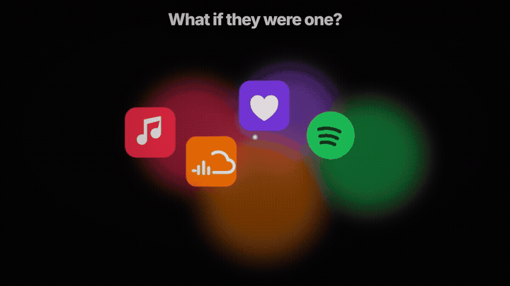](https://github.com/Toastyfil/cloudy-music-player/raw/main/docs/why-five-apps.mp4)

<p align="center"><sub><a href="https://github.com/Toastyfil/cloudy-music-player/raw/main/docs/why-five-apps.mp4">Watch the 25-second cut with sound</a> (MP4, 1080p)</sub></p>

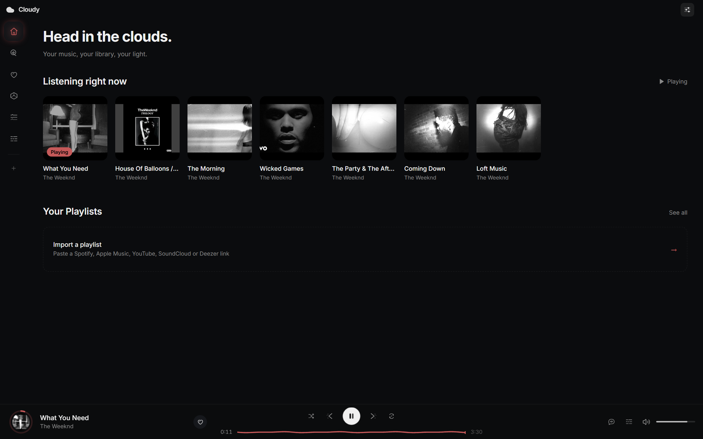

---

## What it is

Cloudy searches YouTube Music, SoundCloud, Deezer, Apple Music and Audius at once and interleaves the results, each row labelled with the catalog it came from. Every hit is matched to the recording Cloudy plays, so an Apple Music or Deezer result is not a link out — it is the track, ad-free, in your queue, cached to disk after the first listen.

It is deliberately small in scope. There is no feed, no "for you" page, no social layer and no login. Type a song, a record or an artist, press play.

---

## Highlights

| | |
| --- | --- |
| **Five catalogs, one search** | YouTube Music, SoundCloud, Deezer, Apple Music and Audius, merged and deduplicated into a single list. |
| **Lyrics that follow the voice** | Syllable-timed karaoke sweep, readable spacing, dimmed backing vocals, and per-track timing worked out from the audio itself. |
| **A real local library** | Favorites, your own playlists, playlist import from a link, recently played and play counts — all stored on your machine. |
| **Playback that respects the queue** | Gapless prefetch, fades instead of clicks, 10-band EQ, pan, mono, drive, delay, reverb, compression and loudness normalisation. |
| **At home on your desktop** | Native window controls, tray or menu-bar transport, media keys, global shortcuts, Discord presence, `cloudy://` deep links and a mini player. |
| **Yours to look at** | 21 palettes, selectable logo marks and 47 languages, applied instantly without a restart. |

---

## What's new in 1.3

- **Mini player** — minimize Cloudy and it becomes a small always-on-top window: cover, title, transport, nothing else.
- **Now Playing panel** — artwork, transport and lyrics together, with the buttons sitting under the cover.
- **Drag anything into place** — reorder the sidebar rail, playlist rows and your own playlists by dragging.
- **New settings layout** — You, Interface, Appearance, Banners, Tracks, Playback, Audio, Shortcuts, Advanced, Storage and About, with floating-panel blur on its own control.
- **Cleaner lists everywhere** — tracks, preview rows and the player bar now share one row surface, so nothing drifts between pages.

The full list lives in [CHANGELOG.md](CHANGELOG.md), and every release page is written from the commits it contains.

---

## Screenshots

Taken from the app running on Windows at 1600 px wide in the **Mono** palette.

| | |
| --- | --- |
| **Search** — five catalogs in one list, each labelled<br> | **Artist** — popular tracks, play all, shuffle, follow<br> |
| **Releases** — albums, singles and related artists<br>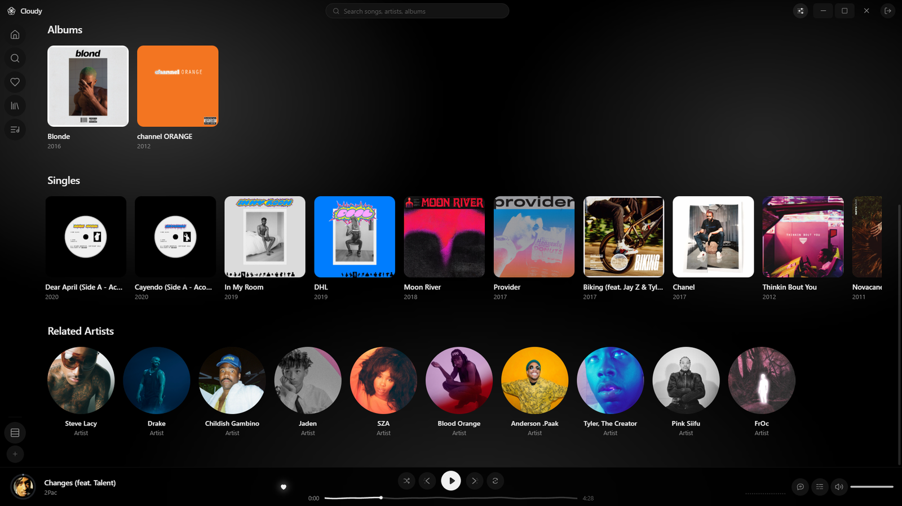 | **Album** — cover, year, runtime, catalog order<br>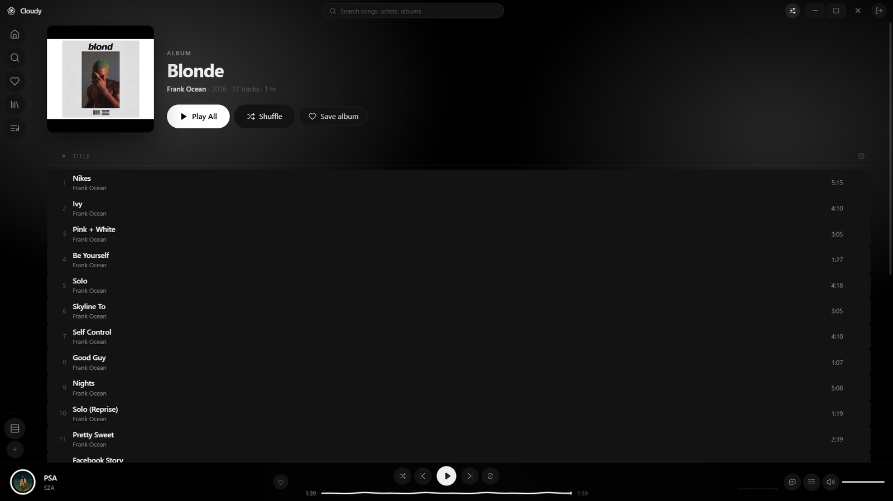 |
| **Lyrics** — syllable sweep, active line in the accent colour<br> | **Fullscreen lyrics** — wavy progress ring, `Esc` to exit<br>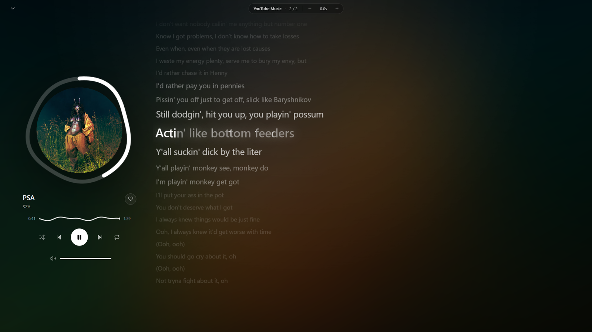 |
| **Import** — paste a Spotify, Apple Music, YouTube, SoundCloud or Deezer link<br>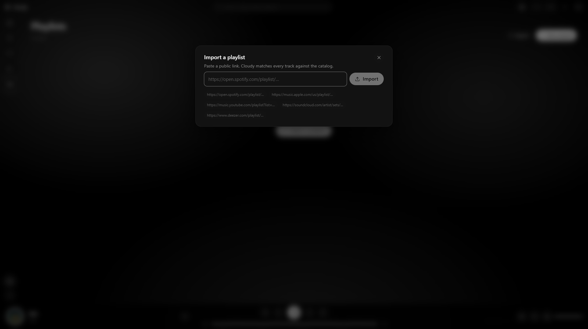 | **Queue** — reorder, shuffle, repeat, remove<br>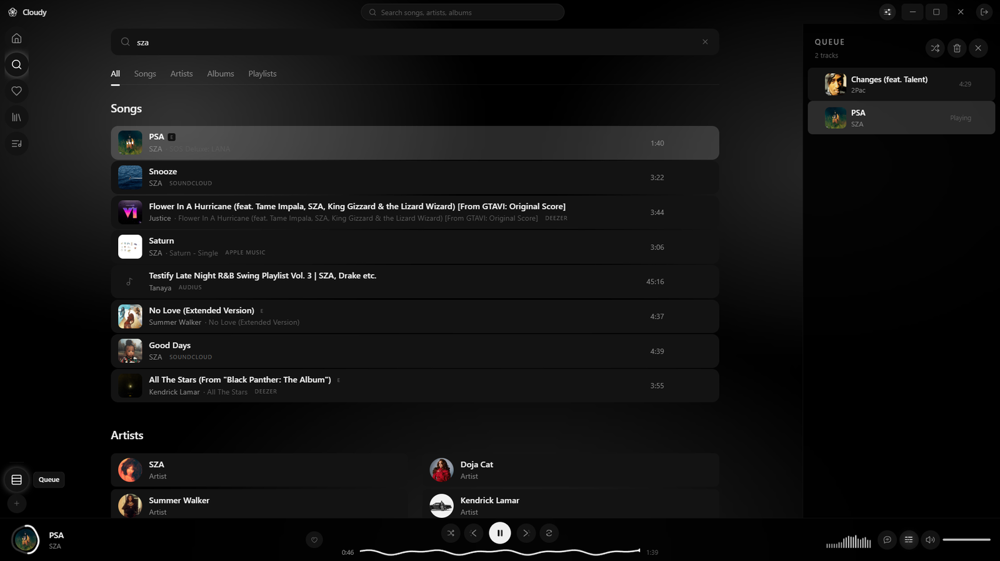 |
| **Appearance** — 21 palettes and 47 languages<br>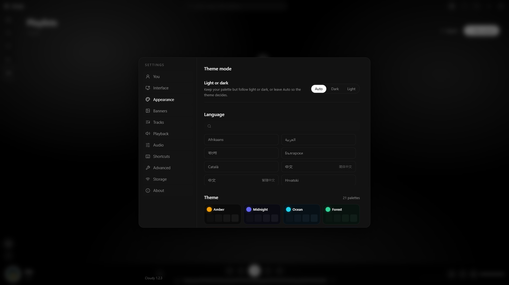 | **Audio** — output device, 10-band EQ and presets<br>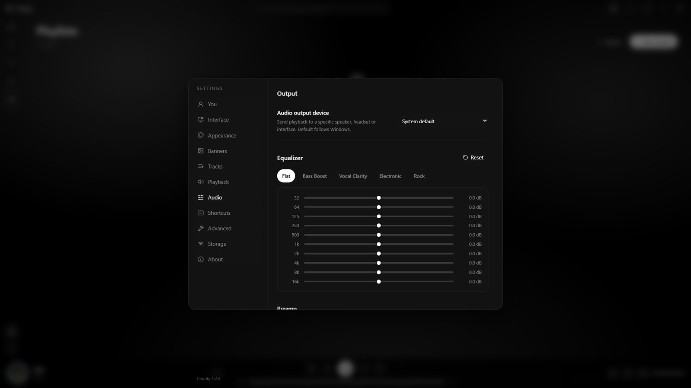 |
| **Library** — songs, albums, artists and playlists in one place<br>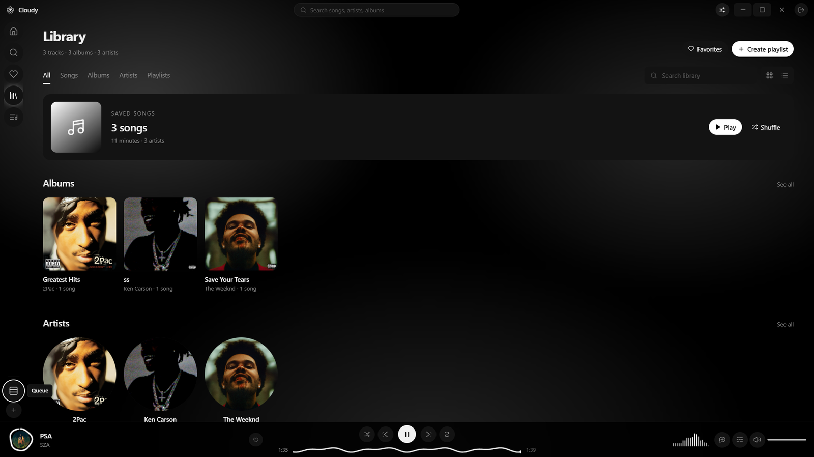 | **Favorites** — liked songs, artists and albums<br>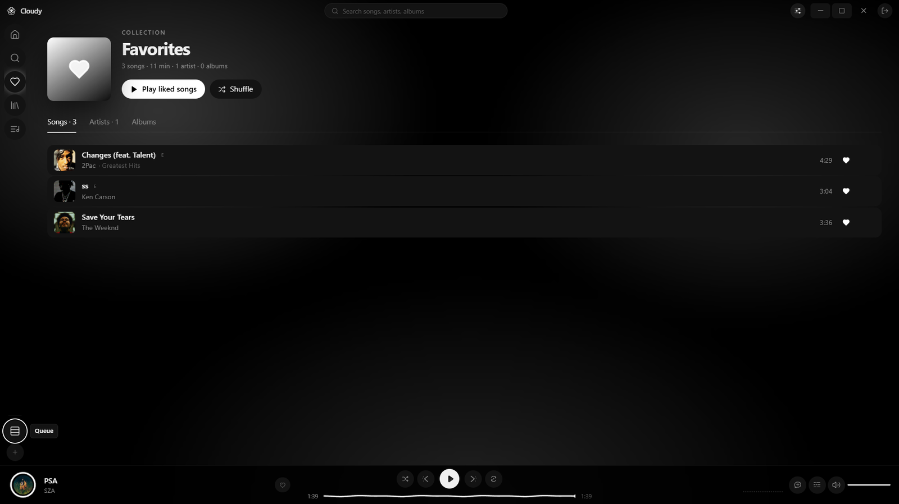 |

---

## Features

**One search, five catalogs.** Results from all five sources land in a single list. Each row shows where it came from, duplicates are folded together, and anything external is resolved to the audio Cloudy plays.

**Lyrics that follow the voice.** Syllable-timed LRC with a karaoke sweep across the line being sung, distance-based typography that keeps the next lines readable, and backing vocals dimmed rather than shouted. Drag or wheel the lyrics and auto-scroll pauses, then picks up again a few seconds later.

**Alignment you do not have to think about.** Recordings do not always match the timing of the lyric file — a YouTube upload with a longer intro is the usual culprit. Cloudy analyses the audio: it isolates the vocal band, builds a loudness envelope and finds the shift where the lines line up with the singing. That runs once per track the first time you play it, is remembered, and can be redone with one press of **Auto**. A manual nudge and a "sync this line to the playhead" control cover anything stubborn.

**Playback that respects the queue.** Gapless prefetch of the next tracks, fades instead of clicks, a 10-band EQ with presets, stereo pan, mono output, drive, delay, reverb, compression and loudness normalisation. A late `play()` from a track you already skipped is ignored, so switching songs never gives you a burst of the previous one.

**A music library that stays on disk.** Favorites for songs, artists and albums, playlists you create, playlist import from a public link, recently played and play counts shown on Home. Library, history, settings and cached audio are local; nothing is uploaded.

**Small when you want it small.** Minimize Cloudy and it turns into a mini player: cover, title, transport and nothing else. The tray or menu-bar menu adds transport controls, OS media keys, global shortcuts and Discord presence.

**Makes itself at home on either OS.** Native Windows frame controls; on macOS the real traffic lights under a hidden title bar and a template icon in the menu bar. `cloudy://` deep links open the app straight onto a track or playlist.

**21 palettes, 47 languages.** Dark, light and tinted themes, a choice of logo marks and a complete interface translation — all applied instantly, no restart.

---

## Install

Everything is on the [Releases page](https://github.com/Toastyfil/cloudy-music-player/releases).

**Windows** — download `Cloudy-<version>-setup.exe` and run it. The installer bundles `yt-dlp`, so playback works without installing anything else.

**macOS** — `Cloudy-<version>-arm64.dmg` for Apple Silicon, `Cloudy-<version>-x64.dmg` for Intel. Open the DMG and drag Cloudy into Applications.

**Linux** — `Cloudy-<version>-x64.AppImage` is a single file you can run from anywhere; `Cloudy-<version>-x64.deb` installs it with a menu entry and uninstalls cleanly through `apt`.

```sh
chmod +x Cloudy-<version>-x64.AppImage
./Cloudy-<version>-x64.AppImage

# or, as a system package:
sudo apt install ./Cloudy-<version>-x64.deb
```

The AppImage needs FUSE 2 (`libfuse2` on Ubuntu 22.04 and newer, `fuse2` on Arch and Fedora); without it, run it with `--appimage-extract-and-run`. Both builds target 64-bit Ubuntu 22.04 and newer (glibc 2.35+), Debian 12, and their derivatives.

The macOS builds are not signed with an Apple Developer ID, so the first launch is blocked by Gatekeeper. Either right-click the app → **Open** → **Open**, or clear the quarantine flag once:

```sh
xattr -dr com.apple.quarantine /Applications/Cloudy.app
```

Windows builds are not code-signed either, so SmartScreen asks for **More info → Run anyway** on first launch. Upgrades keep your library, playlists, settings and cached audio.

---

## Build from source

Requirements: Node 22+, npm, and `yt-dlp` on your `PATH` for development (release builds bundle it).

```sh
git clone https://github.com/Toastyfil/cloudy-music-player.git
cd cloudy-music-player
npm ci
npm ci --prefix server   # backend dependencies, bundled into the app
npm run server           # catalog + lyrics service on http://127.0.0.1:3456
npm run dev              # renderer on http://127.0.0.1:3000 (second terminal)
npm run electron:dev     # or run the whole app inside Electron instead
```

Packaging:

```sh
npm run electron:build:win    # NSIS installer in release/
npx electron-builder --mac    # DMG; must be run on macOS
npx electron-builder --linux  # AppImage / deb
```

`npm run dist:win:signed` packages with a code-signing certificate from `certificates/cloudy.pfx` or `CSC_LINK`; `-- --dev` signs with a throwaway self-signed certificate to test the pipeline. Signed releases are what stop antivirus and SmartScreen from flagging Cloudy — repository secrets and certificate steps are in [docs/signing.md](docs/signing.md).

---

## How it fits together

| Layer | Tech |
| --- | --- |
| Desktop shell | Electron 37 — frameless window, mini player, tray, `cloudy://` deep links, native media keys |
| Frontend | React 19 + TypeScript, Vite, Tailwind CSS v4, Framer Motion |
| Audio | One `<audio>` element through a WebAudio graph: gain → EQ → pan → analyser → DSP chain |
| Local service | Node + Express on `127.0.0.1:3456`: catalog search, stream resolution, lyrics, artwork |
| Storage | SQLite for library, favorites, playlists and history; audio and lyrics cached on disk |
| Packaging | electron-builder, GitHub Actions for the Windows installer, both macOS architectures and the Linux AppImage/deb |

The service is bundled inside the app and started on launch. Nothing leaves your machine except the catalog requests needed to search and fetch audio.

**Where your data lives**

- Library, playlists, settings and history: the app's SQLite database in your user profile.
- Audio and lyrics caches: `~/.cloudy/` (`audio/`, `lyrics/`).
- No accounts, no analytics, no crash reporting, no telemetry of any kind.

---

## Releases

Every update ships as a tagged release: a version bump, a `CHANGELOG.md` entry and `git tag vX.Y.Z`. The release workflow builds the Windows installer, both macOS DMGs and the Linux AppImage and deb, then writes the notes from the commits since the previous tag — what changed, how to install, and checksums. The process is written down in [docs/releases.md](docs/releases.md).

---

## License

Cloudy is free and open source under the [MIT License](LICENSE). You can use it, change it, ship it, sell it — keep the copyright notice and the license text with it.

It is an independent project: not affiliated with, endorsed by, or supported by YouTube, SoundCloud, Deezer, Apple or Audius. It plays audio the same way a browser does and stores nothing you did not ask it to play.

Contributions are welcome — issues for bugs and rough edges, pull requests for fixes. `npm run typecheck` and `npm run build` are the checks CI runs.

---

**Cloudy · Head in the clouds.**
